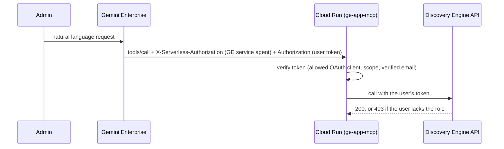

# 🌌 Gemini Enterprise MCP Server & Agent Skills

[](https://opensource.org/licenses/Apache-2.0)
[](https://www.typescriptlang.org/)
[](https://modelcontextprotocol.io/)
[](https://badge.socket.dev/npm/package/ge-app-mcp/latest)

Welcome to the **Gemini Enterprise MCP Server**.

> [!IMPORTANT]
> **Unofficial Project**: This is **NOT** an official Google repository or product. It is an absolutely unofficial, personal initiative created to support and facilitate the adoption of Gemini Enterprise.

This open-source project (released under the Apache 2.0 license) implements a **Model Context Protocol (MCP)** server in **TypeScript/ESM** to connect AI coding assistants and orchestration frameworks with the powerful **Google Cloud Discovery Engine** APIs (which power Gemini Enterprise App).

The server handles both **Data Plane** operations (semantic search, conversational RAG with the Answer API, document retrieval) and **Control Plane** operations (automated datastore creation, JSON schema management, ranking/Serving Configs tuning, and SaaS connector configurations).

> [!TIP]
> **Search only?** Google Cloud offers a managed remote MCP server for Agent Search at
> `https://discoveryengine.googleapis.com/mcp` (`search`, `conversational_search`, `list_engines`; see the
> [official reference](https://docs.cloud.google.com/generative-ai-app-builder/docs/reference/mcp)). Prefer it for
> search. This server focuses on administration (apps, data stores, connectors, features, models, assistant, agents,
> IAM, licenses), which the managed server does not expose as of 2026-10-25. Both can be used side by side.

---

## 🚀 Key Features & API Coverage

The server provides complete (100% operational coverage) mapping to the core gRPC/REST endpoints of Google Cloud Discovery Engine:

### 🔍 Data Plane (Semantic Search & RAG)
*   **Search (`gemini_enterprise_search`)**: Semantic search on one data store (`datastore_id`) or across every source attached to an app (`engine_id`), with filters, ordering, relevance threshold, pagination and cost-saving `search_addon_spec`.
*   **Grounded answers (`gemini_enterprise_ask`)**: Answer API with citations, grounding score, related questions and multi-turn sessions.
*   **Document Retrieval (`gemini_enterprise_get_document`)**: Full content and metadata of an indexed document.

### ⚙️ Control Plane (Administration & Tuning)
*   **Read-only inspection (`gemini_enterprise_inspect`, `gemini_enterprise_inspect_licenses`)**: Dedicated `readOnlyHint: true` tools covering every control-plane resource and license pool/usage check so audits and pre-change checks run in parallel with zero confirmation prompts inside Gemini Enterprise.
*   **Apps (`gemini_enterprise_manage_apps`)**: CRUD and IAM for apps (engines).
*   **Data stores (`gemini_enterprise_manage_datastore`)**: CRUD, resource-level IAM on data stores and connector collections, and project-level data store access control.
*   **Connectors (`gemini_enterprise_configure_connector`)**: Real DataConnector API: get, setup, connector runs, and `citation_mappings` for custom MCP data stores.
*   **Target sites, documents, schema, controls**: website crawling patterns, GCS/BigQuery import and purge, JSON schemas, boost/filter/synonym controls.
*   **Feature toggles (`gemini_enterprise_manage_features`)**: All 38 web app toggles of the API (Projects, Workflow Builder, speech-to-text, Canvas, Skills, orchestration, ...), with a safe `enable_all_features` and `cleanup_invalid_keys`.
*   **Models (`gemini_enterprise_manage_models`)**: Model availability (Gemini 4 Argon, 3.8/3.7/3.6 Flash, 3.1 Pro, image models, Claude Opus/Sonnet 5.5) plus a generic `model_configs` map.
*   **Assistant (`gemini_enterprise_manage_assistant`)**: The real `default_assistant`: system instructions, models, web grounding, banned phrases, Model Armor, Sensitive Data Protection, Knowledge Catalog, chat history retention.
*   **Search UI, observability, Knowledge Graph**: autocomplete, feedback, pinned links, OpenTelemetry and prompt logging, Knowledge Graph toggles.
*   **Agents (`gemini_enterprise_manage_agents`)**: A2A, Agent Designer (low-code, multi-agent) and ADK agents on Agent Engine, with sharing scope and starter prompts.
*   **Platform skills (`gemini_enterprise_manage_skills`)**: Vertex AI Skill Registry (create, get, retrieve, revisions, patch, delete).
*   **Operations (`gemini_enterprise_get_operation`)**: Poll long-running operations returned by other tools.
*   **Licenses (`gemini_enterprise_manage_licenses`)**: License pools, seat usage, assign and unassign.

---

## 🛠️ Installation & Setup

### 1. Prerequisites
*   **Node.js**: v22 or higher.
*   **Google Cloud SDK (`gcloud`)** installed and configured.
*   An active Google Cloud project with the **Discovery Engine API** enabled.

### 2. Local Authentication
Configure your local Application Default Credentials (ADC) pointing to your target GCP project:
```bash
gcloud auth application-default login
```

### 3. Environment Variables
Create a `.env` file in the root of the project (or set variables in your shell/IDE environment):
```env
GCP_PROJECT=your-gcp-project-id
GCP_LOCATION=global # optional, defaults to global (supports us, eu, etc.)
GCP_COLLECTION=default_collection # optional, defaults to default_collection

# OPTIONAL BUT RECOMMENDED:
# Set this variable if you encounter a local quota/billing project mismatch error from gcloud.
GOOGLE_CLOUD_QUOTA_PROJECT=your-gcp-project-id

# SECURITY SCOPES (Enforces Least Privilege):
# Comma-separated list of allowed scopes: search, admin, billing.
# Example: Use 'search' for standard coding assistants, and 'search,admin' for SRE agents.
# Defaults to 'search,admin,billing' if not specified.
MCP_SCOPES=search,admin,billing
```

> [!NOTE]
> **Quota & Billing Troubleshooting**:
> If during execution you receive an error like `7 PERMISSION_DENIED: Discovery Engine API has not been used in project...`, your local user credentials are trying to attribute billing quotas to a disabled local sandbox project. Setting `GOOGLE_CLOUD_QUOTA_PROJECT` forces the SDK to attribute quotas to the correct project.

### 4. Build the Project
Install dependencies and compile TypeScript files into JavaScript ESM:
```bash
npm install
npm run build
```

---

## 🧪 Testing Suite

To ensure stability and facilitate onboarding, the repository includes a suite of testing scripts under the `tests/` directory to validate connectivity, security, and the MCP interface:

1.  **`test_mcp_client.mjs` (MCP Protocol Handshake)**:
    Performs a standard handshake with the MCP server via stdio and prints the list of registered tools with their JSON schemas.
    ```bash
    node tests/test_mcp_client.mjs
    ```
2.  **`test_suite_readonly.mjs` (GCP Read-Only Validation)**:
    Scans the available datastores in the configured GCP project, querying schemas, target sites, serving controls, and testing search queries.
    ```bash
    node tests/test_suite_readonly.mjs
    ```
3.  **`test_admin_write.mjs` (GCP Control Plane Safe Write/Delete)**:
    Executes a complete read/write lifecycle on the Control Plane (creates a temporary synonym control, verifies its existence via list, and immediately deletes it). **100% safe with zero residue left on your Cloud project.**
    ```bash
    node tests/test_admin_write.mjs
    ```
4.  **`test_agents_write.mjs` (Native Agent Lifecycle Safe Write/Delete)**:
    Executes a complete lifecycle check on native Discovery Engine Agents (creates a temporary agent, lists and updates it, then deletes it with zero residues remaining).
    ```bash
    node tests/test_agents_write.mjs
    ```
5.  **`test_iam.mjs` (App IAM Policy Roundtrip Validation)**:
    Verifies that retrieving and setting IAM policies on individual Engines/Apps works correctly and safely.
    ```bash
    node tests/test_iam.mjs
    ```
6.  **`test_mcp_scopes.mjs` (Scope & Security Enforcement Suite)**:
    Validates that environment-based tool restrictions (`MCP_SCOPES`) work correctly. It tests `search` only, `search,billing`, and full scopes, verifying that unauthorized attempts to call out-of-scope tools are securely rejected with access denied responses.
    ```bash
    node tests/test_mcp_scopes.mjs
    ```

---

## 🏃 Running & Installing the Server

The MCP server communicates via **stdio** transport by default (see below for the remote HTTP mode). You can easily register it, compile it locally, or automate the entire setup.

### ⚡ Option A: Automatic Installation (Highly Recommended)
You can automatically add and register `ge-app-mcp` in your favorite AI coding assistant (Claude Desktop, Cursor, Claude Code, etc.) using the open-source [add-mcp](https://github.com/neondatabase/add-mcp) utility:

```bash
npx add-mcp ge-app-mcp --env "GCP_PROJECT=your-gcp-project-id" --env "MCP_SCOPES=search,admin,billing"
```
*(This automatically discovers your installed AI agents, configures their configuration files, and passes the required environment variables securely.)*

### Option B: Manual Execution via `npx`
To run the server directly from npm without cloning:
```bash
npx -y ge-app-mcp
```

### Option C: Compile and Run Locally
```bash
# Clone, install dependencies, compile and start:
npm install
npm run build
npm start

# In development with hot-reloading:
npm run dev
```

---

## 🏢 Using the Server inside Gemini Enterprise (Cloud Run, on behalf of the user)

Gemini Enterprise can call these tools as **actions** through a *Custom MCP Server* data store. In this mode
the server runs on Cloud Run over Streamable HTTP and **every call is executed with the signed-in user's own
Google OAuth token**: users can only do what their IAM roles allow, and audit logs show the real user.
Local harnesses (Antigravity, Claude Code, Codex, Cursor...) are unaffected and keep using stdio.



**1. Allow Custom MCP data stores** (Organization Policy Administrator, project level):
```bash
cat > policy.yaml <<'YAML'
name: projects/PROJECT_NUMBER/policies/discoveryengine.managed.disableCustomMcpServerConnector
spec:
  rules:
  - enforce: false
YAML
gcloud org-policies set-policy policy.yaml --update-mask=spec
```
If the project is VPC-SC protected or listed in `enforcedProjects`, also add `custom_mcp` to
`allowedDataSources` and the Cloud Run host plus `accounts.google.com` and `oauth2.googleapis.com` to `allowedEgressFqdns`.

**2. Create an OAuth client** (Google Auth Platform, type *Web application*, consent screen *Internal*) with the
redirect URI `https://vertexaisearch.cloud.google.com/oauth-redirect`.

**3. Deploy to Cloud Run** (private service, runtime service account without roles):
```bash
gcloud iam service-accounts create ge-app-mcp-runtime --project=PROJECT_ID
gcloud run deploy ge-app-mcp --source . --project=PROJECT_ID --region=REGION \
  --no-allow-unauthenticated \
  --service-account=ge-app-mcp-runtime@PROJECT_ID.iam.gserviceaccount.com \
  --set-env-vars="^@^GCP_PROJECT=PROJECT_ID@MCP_SCOPES=search,admin,billing@ALLOWED_OAUTH_CLIENT_IDS=CLIENT_ID@ACCEPTED_OAUTH_SCOPES=https://www.googleapis.com/auth/discoveryengine.readwrite@ALLOWED_EMAIL_DOMAINS=example.com"
gcloud run services add-iam-policy-binding ge-app-mcp --region=REGION --project=PROJECT_ID \
  --member=serviceAccount:service-PROJECT_NUMBER@gcp-sa-discoveryengine.iam.gserviceaccount.com \
  --role=roles/run.invoker
```
The image is built from the `Dockerfile` (distroless, non-root, `MCP_TRANSPORT=http`).

**4. Create the data store** in the Gemini Enterprise console: *Data stores → Create → Custom MCP Server → OAuth 2.0*:

| Field | Value |
| :--- | :--- |
| MCP Server URL | `https://<service>.run.app/mcp` (use the default `run.app` URL, not a custom domain) |
| Authorization URL | `https://accounts.google.com/o/oauth2/v2/auth` |
| Authorization URL Parameters | `&access_type=offline&prompt=consent` |
| Token URL | `https://oauth2.googleapis.com/token` |
| Client ID / Secret | from step 2 |
| PKCE | enabled |
| Scopes | `openid email https://www.googleapis.com/auth/discoveryengine.readwrite` |
| MCP Server Description *(Advanced options)* | Short description of the server's capabilities so the assistant knows when to route requests to it |

Then open *Actions → Reload custom actions*, select all discovered actions, click *Enable actions*, and connect the
data store to the app used by your administrators (*Connected data stores → Add existing data stores*). On first use
in the Gemini Enterprise web app, each administrator opens *Sources / Connectors* in the chat bar and clicks
**Authorize** next to the connector to complete per-user OAuth consent. Read-only tools (`search`, `ask`,
`get_document`, `get_operation`, `inspect`, `inspect_licenses`) run in parallel without a confirmation prompt;
mutating actions (`manage_*`, `configure_connector`) show a `Review` card (**Send** / **Cancel**) and run sequentially.

**5. Grant roles to administrators**: their usual Discovery Engine roles plus
`roles/serviceusage.serviceUsageConsumer` on the project (the server sends `x-goog-user-project`).

> [!IMPORTANT]
> Security model: the server never uses its own identity in HTTP mode (no token → 401), only accepts tokens
> minted for `ALLOWED_OAUTH_CLIENT_IDS`, and logs one line per tool call (tool, action, user, outcome) without
> arguments or tokens. Restrict who sees the actions with data store IAM
> (`gemini_enterprise_manage_datastore` → `set-iam`, `set-resource-access-control`) or a dedicated admin app.
> `gemini_enterprise_manage_skills` needs the `cloud-platform` scope and is hidden when only
> `discoveryengine.readwrite` is accepted. See [ADR-0003](docs/adr/0003-remote-http-transport-with-end-user-oauth.md).

The distributed skills can be imported into the Gemini Enterprise web app (*Skills → Add skill → Upload skill*,
select `SKILL.md` → **Import**), invoked in chat with `/<skill-name>` (e.g. `/admin-assistant`), and shared with
other administrators.

---

## 🧩 Managing Pre-Built Agent Skills

This project fully supports the open **Agent Skills** specification (compatible with Vercel's `skills` CLI and standard coding agents). You can manage them in two ways:

### ⚡ Option A: Automatic via Vercel's `skills` CLI (Recommended)
You can instantly install and load all our pre-built enterprise skills into your workspace using Vercel's [skills CLI](https://github.com/vercel-labs/skills):

```bash
npx skills add miticojo/ge-app-mcp
```

### Option B: Handled via the Local package CLI
If you prefer, you can use the built-in CLI utility bundled with our package to list and copy skills manually:

#### 1. List Available Pre-Built Skills
```bash
npx ge-app-mcp skills list
```

#### 2. Install a Pre-Built Skill
Copy a pre-built skill folder into your local project workspace (defaults to `./skills/` if target directory is omitted):
```bash
npx ge-app-mcp skills install <skill-id> [target-directory]

# Example:
npx ge-app-mcp skills install admin-assistant ./my-skills
```

---

## 🤖 AI Agents & IDE Integration (Cursor, Windsurf, Claude Desktop, etc.)

For detailed, copy-paste configurations to integrate this server into your preferred AI agent workflows, see our dedicated integration guide:

👉 **[AGENTS.md](file://./AGENTS.md)**

It provides comprehensive configurations for:
*   **Cursor / Windsurf / Claude Desktop** (Direct stdio setup using `npx ge-app-mcp`).
*   **Google Agent Development Kit (ADK)** (Native orchestration with `MCPToolset`).
*   **LangChain & LangGraph** (Python & TypeScript integrations).
*   **CrewAI**.

---

## 📂 Project Structure

```text
ge-app-mcp/
├── LICENSE                    # Apache 2.0 License
├── README.md                  # This file
├── AGENTS.md                  # Integration guide for AI Agents (ADK, LangChain, Cursor)
├── package.json
├── tsconfig.json
├── src/
│   ├── index.ts               # MCP Server entrypoint (tool routing, stdio/http)
│   ├── config.ts              # Environment configuration
│   ├── gcp.ts                 # Request-scoped credentials and REST helpers
│   ├── http.ts                # Streamable HTTP transport and token verification
│   ├── annotations.ts         # MCP tool annotations
│   ├── domain/                # Pure domain logic (features, models, assistant, licensing, citations)
│   └── tools/
│       ├── search.ts          # Search tool implementations (Data Plane)
│       ├── admin.ts           # Admin tool implementations (Control Plane)
│       └── billing.ts         # Billing & license management tools (Control Plane)
└── skills/                    # Agent Skills templates conforming to Vercel Agent Skills standard
    ├── admin-assistant/
    │   └── SKILL.md           # Skill for DevOps and infrastructure orchestration
    ├── enterprise-context/
    │   └── SKILL.md           # Skill for secure zero-trust enterprise search
    ├── codebase-rag/
    │   └── SKILL.md           # Skill for debugging and conversational code context
    └── agent-workflow-architect/
        └── SKILL.md           # Skill for designing and governing agents and platform skills
```

---

## 📄 License

This project is licensed under the **Apache License, Version 2.0**. See the [LICENSE](file://./LICENSE) file for more information.
